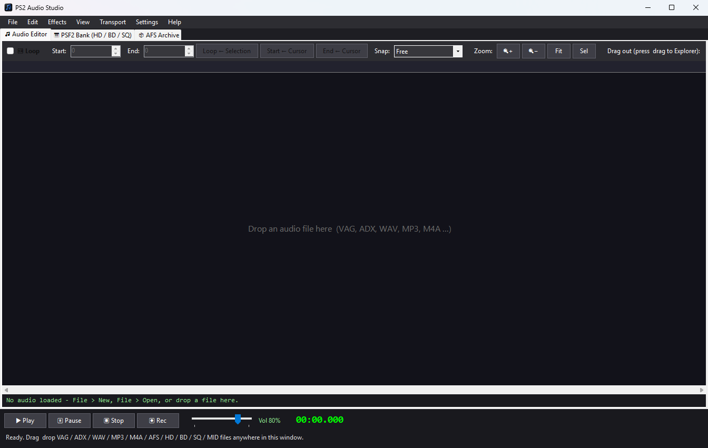

# PS2 Audio Studio



**Made by DarthKrayt333**, also the author of HMSTH Modding Tool.

A Windows audio editor, builder and converter for **PlayStation 2 game modding**.
It reads and writes the audio formats PS2 games use, and lets you edit them in an Audacity-style editor.

> ⚠️ Always keep a backup of your game files. This tool overwrites archives and banks when you save.

## Features

**Audio Editor tab**
- Waveform view with mouse-wheel zoom, scrolling and room past the end of the track
- Cut / copy / paste / delete, fade, amplify, normalize, reverse, invert, silence, crop, resample, mono mix
- Undo / redo, play / pause / record (microphone or PC loopback)
- Loop points with instant looped playback
- Open: VAG, headerless / interleaved VAG, ADX, WAV (reads `smpl` loops), MP3, M4A, AAC, FLAC, WMA
- Save: VAG, ADX, WAV, MP3, M4A, raw interleaved PS-ADPCM
- On save, choose the **sample rate** and **mono / stereo**

**PSF2 Bank tab**
- Open HD + BD (+ SQ) sets, list samples, extract as VAG or WAV, replace samples, save HD + BD
- SQ songs: play through the bank, extract MIDI, replace a song from `.mid`, import a new SQ, save SQ
- Loop points are read from the SQ (CC#99, experimental)

**AFS Archive tab**
- Open, extract, replace (auto-converts audio to the entry's format), add, rename, remove, save
- Info column shows rate, channels, length and loop range
- Drag entries out to Explorer

**ADX loops**
- ADX loops work in game for mono and stereo (tested in Capcom vs SNK 2 and Harvest Moon AWL)
- Two layouts in Settings (see below)

**Other**
- Drag and drop onto every tab
- Settings: recording source, what *File > New* clears, looped playback, save-rate prompt, `.bak` backups, ADX layout

## Download

Get the latest build from the **[Releases](https://github.com/DarthKrayt333/PS2AudioStudio/releases/latest)** page:

- **`PS2AudioStudio-vX.Y.Z-win-x64.zip`**: for 64-bit Windows (almost everyone). Unzip and run `PS2AudioStudio.exe`. .NET is included, nothing to install.
- **`PS2AudioStudio-vX.Y.Z-win-x86.zip`**: only for 32-bit Windows (less tested).

Windows 10 / 11. The exe is not code-signed, so SmartScreen may warn on first run: choose *More info > Run anyway*. The full source is in this repository.

## Build from source

1. Install the .NET 8 SDK (or Visual Studio 2022 with the **.NET desktop development** workload).
2. Open `PS2AudioStudio.sln`.
3. Restore NuGet packages (NAudio 2.2.1), then press **F5**.

## ADX loop notes

In game tests (Capcom vs SNK 2, Harvest Moon AWL), the game seeks to the loop start by **byte offset**, so that offset must be sector-aligned (a multiple of 0x800) and frame-aligned. The encoder handles this automatically, in one of two layouts (Settings > *ADX loop layout*):

| Layout | What it does |
|---|---|
| **Compact** (default) | Audio untouched. Header size is non-standard. |
| **CRI standard (`07 FC`)** | Standard 0x800 header. Adds a little silence at the start (up to about 0.34 s stereo or 0.68 s mono at 48 kHz) so the loop start lands on a sector. |

Both loop in game. Loops are only written when the **Loop** box is ticked.

## Known limitations

- Windows only.
- Drag and drop does not work if the app is run as Administrator but Explorer is not (a Windows restriction). Run the app normally.
- ADX: standard (type 3) and exponential (type 4) decode. AHX and **encrypted** ADX are not supported (encrypted files decode as noise). The encoder is a simple fixed-coefficient one; quality is not identical to CRI's tools.
- MP3 / M4A export uses Windows Media Foundation (availability depends on your Windows edition; allowed sample rates are limited).
- The PSF2 renderer is an offline sampler, not a cycle-exact SPU2: no reverb, no LFO / mod wheel, linear velocity curves.
- "Replace song from .mid" writes one merged track. Aftertouch and sysex are dropped.
- Replacing a bank sample with a different length rebuilds the BD and patches the HD table.
- The save-rate / channels dialog is used by the Audio Editor's Save As. Drag-out and AFS / bank replace paths do not use it.
- Settings are stored in `%AppData%\PS2AudioStudio\settings.json`.

<!-- Self-test: remove these comment markers only after the tests pass on a clean clone.
## Self-test

```
cd tests\CoreTests
dotnet run -c Release
```
-->

## Project layout

```
PS2AudioStudio/                  (repository root)
  PS2AudioStudio.sln
  LICENSE
  README.md
  .gitignore
  docs/                          screenshot-editor.png
  tests/CoreTests/               self-test console project
  PS2AudioStudio/                the app project
    PS2AudioStudio.csproj
    Program.cs
    Assets/                      app.ico, app_128x128.ico
    Audio/                       AudioBuffer, IAudioCodec, VagCodec, AdxCodec, AdxLayout,
                                 AdxLayoutCri, AdxLoopInfo, StandardCodec, AudioIO,
                                 AudioPlayer, Psf2Renderer, RecordDevices
    Archives/                    AfsArchive, Psf2Bank, SqSequence
    Controls/                    WaveformControl
    Forms/                       MainForm (+ .Editor, .Psf2, .Afs), SettingsForm,
                                 SaveRateDialog, AppIcon, DragOut, Ui
    Settings/                    AppSettings
```

## License

MIT – see [LICENSE](LICENSE). Not affiliated with Sony, CRI Middleware or any game publisher.
No game assets are included in this repository.

## Credits

- [NAudio](https://github.com/naudio/NAudio) (MIT)
- CRI ADX header layout as documented by the community (e.g. vgmstream)
